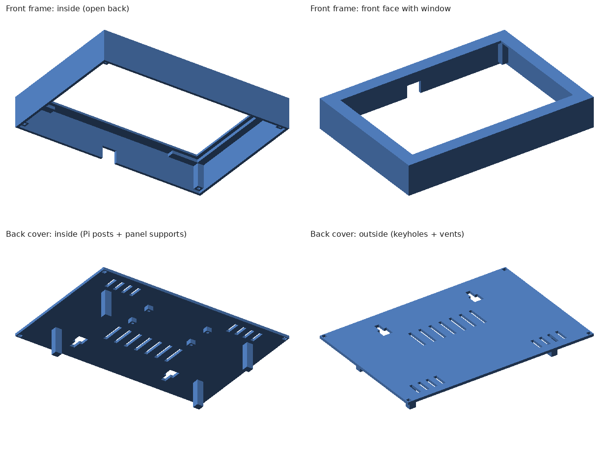

# 3D-printed case: Waveshare 7.5" e-Paper HAT (V2) + Raspberry Pi Zero 2 WH



Two parts, no supports needed:

| File | What it is | Size | Print orientation |
|---|---|---|---|
| `case_front.stl` | Front frame: window, panel pocket, screw columns | 189 × 130 × 30 mm | **Front face down** (as exported) |
| `case_back.stl` | Back cover: Pi Zero posts, 4 panel supports, 2 wall-mount keyholes, vents | 184 × 125 × 26 mm | **Outside face down** (as exported) |

## Print settings (FDM)

- **Material:** PLA or PETG, black looks most like a picture frame
- **Layer height:** 0.2 mm, **walls:** 3, **infill:** 15–20 %
- **Supports:** none
- **Bed size:** at least 190 × 130 mm (most current printers are fine)
- **Plastic:** roughly 80–110 g in total (both parts are thin-walled, so most of it is perimeter)

When ordering from a print service (e.g. Craftcloud), upload both STL files and choose "FDM, PLA, standard quality".

## Also needed

- 4 × M3 self-tapping screws, ~10–12 mm (cover → frame corners)
- 4 × M2.5 self-tapping screws, ~5–6 mm (Pi Zero → cover posts)
- Optional: 4 small felt or foam pads (~1 mm) for the tips of the panel supports

## Assembly

1. Lay the front frame face down on a soft cloth. Drop the e-paper panel in, **display side down**, with its ribbon cable at the **bottom edge**, where the gap in the ledge is.
2. Stick the felt/foam pads on the tips of the 4 tall posts on the back cover. They hold the panel gently in place without pressing on the glass.
3. Screw the Pi Zero onto the 4 small posts on the cover with the GPIO header facing up, then plug the driver HAT onto it. Turn the Pi so its micro-USB ports face the bottom edge (the posts are symmetric).
4. Connect the panel's ribbon cable to the HAT (flip the black latch up, insert, latch down).
5. Plug the micro-USB cable into the Pi's **PWR** port and lead it out through the notch in the bottom wall.
6. Put the cover on and fix it with the 4 M3 screws.
7. To hang it: two screws in the wall, 90 mm apart and level. Fit the screw heads (≤ 8 mm) into the wide part of the keyholes and slide the frame down.

## Before you print: two things to check

These come from the official dimensions, but I couldn't test-fit real parts:

- **Window position.** The window is centred and a little taller than the pixel area, so every pixel shows however the active area sits on your panel, but a sliver of the panel's border may show at the top or bottom. If you'd like it tighter, measure your panel's border and change `WINDOW_H` / `WINDOW_Y_OFFSET` in `make_case.py`.
- **Ribbon cable reach.** The Pi sits in the lower middle of the cover so the panel's ribbon cable reaches the HAT. Hold the parts together before printing the back (or check the ribbon length). If it's short, move `PI_CENTER` closer to the bottom.

## Changing the design

Every size is in the `PARAMETERS` block at the top of `make_case.py`. Edit and run:

```bash
python3 make_case.py
```

It only needs Python and numpy, and rewrites both STL files.
